---

### about

Building from an iPad and a browser — no heavy engines, just React, TypeScript, Canvas, PlayCanvas, Babylon, and whatever ships cleanly on Vercel.

Right now, usually somewhere between:

- 🎮 browser games — pixel hunts, runners, tactical FPS experiments
- 📚 study tools for classes 6–10
- 🎯 an advertising discovery platform built section by section
- ✨ small product sites that feel more like brands than templates

### stack

### things i've been shipping

| project | what it is |
| --- | --- |
| [Apex Protocol](https://github.com/chopdekaradhrit2013-droid) | browser-based multiplayer tactical FPS — PlayCanvas + Supabase |
| Pixel Pursuit | pixel-art hunter / runner in the browser |
| The Hunt | 2D pixel survival — runner vs hunter |
| Echo | social web app — posts, reels, realtime chat |
| ReelFlex | TypeScript web experiment |
| ADHUNT | premium advertising discovery platform |
| [PadhaiMode](https://github.com/chopdekaradhrit2013-droid) | study companion web app |
| [Padho Ek Raat Pehle](https://padhoekraatpehle.vercel.app) | educational notes platform for Class 6–10 |

---

  

